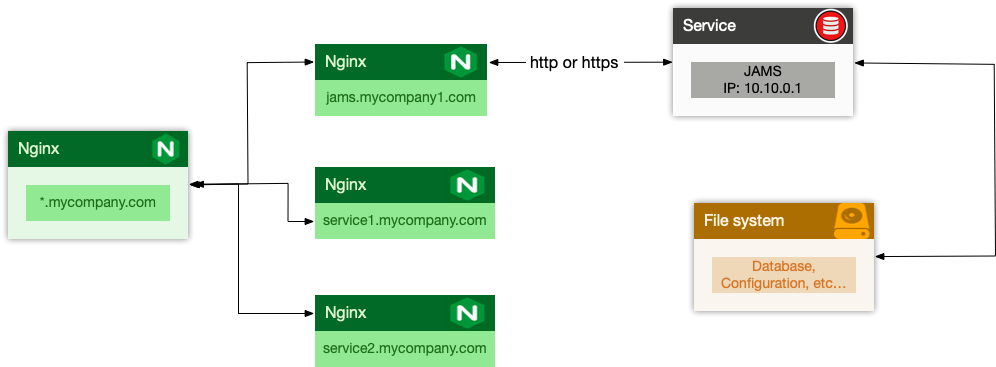

## Troubleshooting and resetting

If you ever need to restart from 0 (i.e. reset everything and drop existing data) you can do so by deleting the following files in the distribution folder (<your project root folder>/jams):

```
The internal jams folder: <your project root folder>/jams/jams
derby.log
oauth.key
oauth.pub
config.json
```

This will reset the server to its original state and you will be able to run the configuration wizard again. Before performing this operation, please make sure to shutdown the server.

# Admin Guide

By default JAMS runs an embedded tomcat server visible on port 8080, however this is not practical for many reasons. This guide is designed
to help you setup Jams to run in a production environment.


## JAMS & Nginx

It is generally not recommended to expose JAMS directly to the outside world and while it is required to run JAMS in SSL mode, we usually
recommend users to place it behind Nginx or a similar web server which proxies requests between the outside world and Jams.

The following is an example map of how you could configure JAMS behind Nginx (the process would be similar if you wanted to use any other type of proxying solution):

<p align="center">
    
</p>

The IP 10.10.0.1 is random, and should be seen as an example.


Typically you would add a new site called ``jams-site.conf`` to your nginx configurations which would contain the following entries if you wanted to place an SSL certificate at the Nginx level:


```
server {
        listen 443 ssl;
        listen [::]:443 ssl;
        ssl on;
    	ssl_certificate /etc/certificates/mycertificate.pem
    	ssl_certificate_key /etc/certificates/mycertificatekey.pem
        client_max_body_size 100M;
        server_name jams.mycompany.com;
        location / {
                proxy_pass              http://10.10.0.1:8080/;
                proxy_set_header        X-Real-IP  $remote_addr;
                proxy_set_header        Host $http_host;
        }
}
```

This is the preferred setup method by most admins, as local traffic is usually ran unencrypted since it is usually either inter-VM connection, a VLAN or another dedicated link.


## Running JAMS as a Linux Service

Running JAMS as a Linux Service is fairly straightforward with systemd - you simply created a service unit file with the following structure:

```
[Unit]
Description=JAMS Server

[Service]
Type=simple
WorkingDirectory=[DIRECTORY WHERE JAMS WAS UNZIPPED]
ExecStart=/usr/bin/java -jar [DIRECTORY WHERE JAMS WAS UNZIPPED]/jams-launcher.jar PORT SSL_CERTIFICATE SSL_CERTIFICATE_KEY

[Install]
WantedBy=multi-user.target
```

The parameters PORT, SSL_CERTIFICATE and SSL_CERTIFICATE_KEY are optional (however, PORT can be used alone whereas the SSL_CERTIFICATE comes in pair with SSL_CERTIFICATE_KEY)