# Getting Started

JAMS is a server application used to enroll Jami clients into an Enterprise context. Currently, JAMS supports 3 sources for user authentication: LDAP, Active Directory and an embedded database.

## Obtaining JAMS

The latest Beta build of JAMS can be downloaded at: ``https://git.jami.net/savoirfairelinux/jami-jams``

## System Requirements

* Windows, Linux or Mac OS operating system
* Java 11 or higher
* 4 GB RAM
* 1 CPU 

## JAMS Concepts

JAMS was built with security in mind, therefore it is intimately related to the X509 certificate management workflows. 

The central concepts which are used in JAMS are the Certification Authority (CA) and the Certificate Signing Requests (CSR).

In the JAMS paradigm, a device (Jami client) requests a certificate to the server then presents it to other devices to be recognized as a valid member of the organization. Therefore, JAMS must be provided with a certificate authority in order to work properly.

In order to be completely secure, JAMS does not generate certificates for devices, but instead issues certificates based on a certificate signing request sent to it by the device, therefore removing the need to send a private key over the wire.

The diagram below shows the entire process of how a device enrolls with JAMS:

<p align="center">
    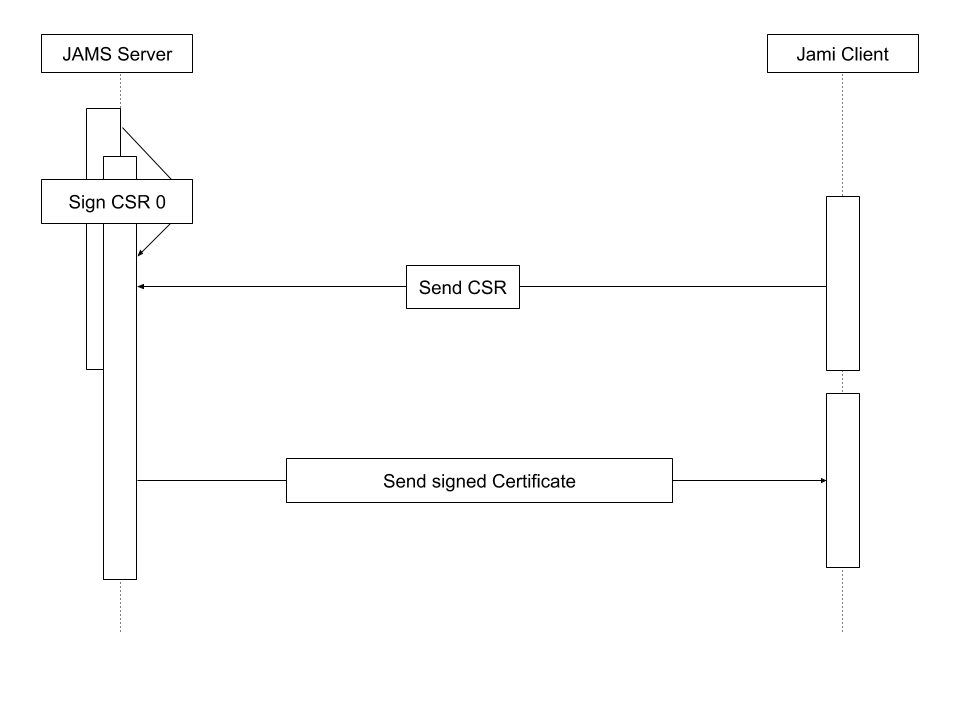
</p>

​    
## Getting Started

1. Download the latest version of JAMS from: <https://jami.net/services/>

2. Unpack the .tar file to a directory of your choice.

3. It is mandatory to run JAMS using a secure SSL connection. To request your SSL certificate files using OpenSSL and generate a pair of PEM and KEY, enter the following command:

``openssl req -newkey rsa:2048 -new -nodes -x509 -days 3650 -keyout server.key -out server.pem``

**Current limitation:** JAMS does not support reading encrypted private keys which require a password unlock.

4. Navigate to the directory where you have extracted the JAMS package and execute the following command:

```java -jar jams-launcher.jar PORT SSL_CERTIFICATE SSL_CERTIFICATE_KEY```

| Argument         | Details       |
| ------------- |-------------  |
| **PORT**      | The TCP port on which you want JAMS to listen for incoming connections |
| **SSL_CERTIFICATE**     | The location of the PEM-formatted SSL Certificate file   |
| **SSL_CERTIFICATE_KEY** | The location of the PEM-formatted key file which is used with the SSL Certificate file from above    |

<br/>
An example of the command would be: 

``java -jar jams-launcher 8080 server.pem server.key``

Please note that any port above 1024 can be safely used to run JAMS.

## Step 1: create your admininistrator account

This account will have administrative control and the rights to manage your users and group of Jami users.

<p align="center">
    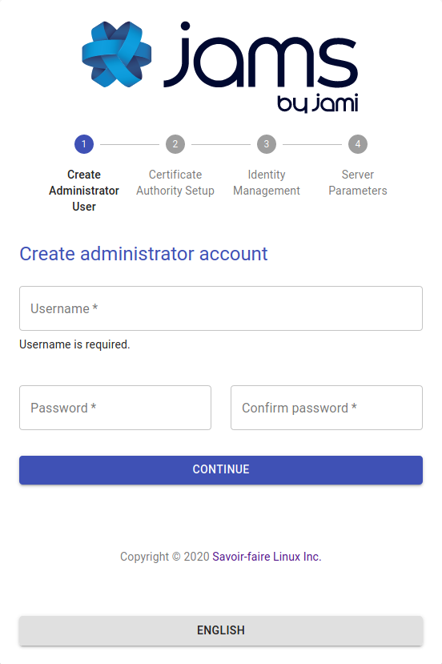
</p>


## Step 2: setup the Certification Authority

The second step is to define your Certification Authority. 

**Important:** a CA is not a server-side ssl certificate, it is a certificate which has the power to issue other certificates. Do not use the import option unless your company's security officer has issued you a CA certificate. Most commercially available certificates (i.e. those issued by godaddy, letsencrypt, etc... ) are not CA certificates. If you are an end-user we highly recommend you use to create a self-signed CA option as providing an incorrect certificate type will lead to a non-functional server.

<p align="center">
    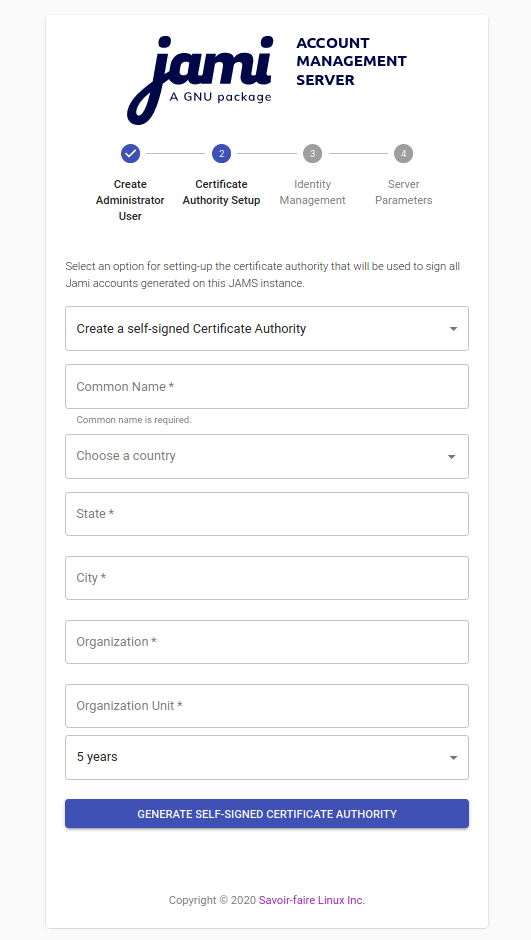
    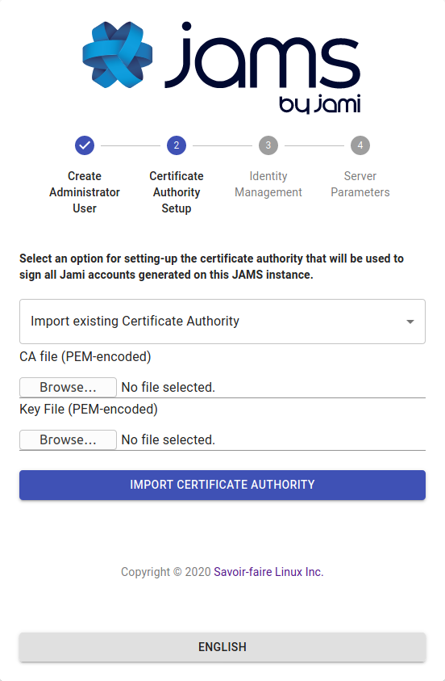
</p>


This certificate will be used to sign the enrollement requests which come from Jami devices. If you are not familiar with the X509 standard, we highly recommend you read the following
articles to get familiar with the processes and practices which surround it:

<https://www.securew2.com/blog/public-key-infrastructure-explained/>
<https://cheapsslsecurity.com/blog/understanding-the-role-of-certificate-authorities-in-pki/> 

## Step 3: setup the user database

JAMS supports 3 different sources for the authentication of users:

* LDAP-compatible directory (such as OpenLDAP)
* Microsoft Active Directory
* Local embedded database

<br/>

### Option 1: LDAP authentication

If your company provides you with LDAP directory for user management, you will need to know its access information and a automated account which has read-only rights to do use look-ups.

<p align="center">
    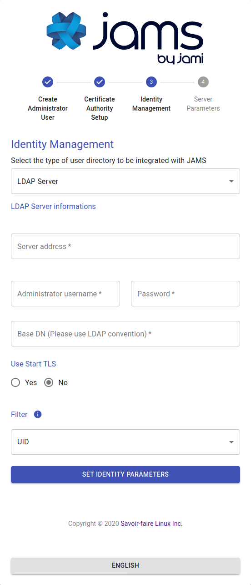
</p>

Your admin should provide you most of this information but we do provide a detailed overview over each field in case you need some extra help:


| Field         | Details       |
| ------------- |-------------  |
| **Use StartTLS**      | Your LDAP server can be configured to use either TLS/STARTTLS or PLAIN sockets, if STARTTLS is used you should mark this as true |
| **Server Address**     | The address of your server with respect to the JAMS server, your LDAP does not need to be publicly accessible but should be accessible to JAMS. You should have either ``ldap://`` or ``ldaps://`` preceding the address.      |
| **Port** | The port on which the LDAP server is listening for requests (usually 389 for PLAIN/STARTTLS and 636 for SSL/TLS)      |
| **Administrator Username** | This is **NOT** the LDAP's administration account credentials, but the credentials of the account which has Read permissions to the LDAP database in order to lookup users. The format is generally ``cn=bot,ou=robots,dc=domain,dc=org``     |
| **Password** | The password used by the account above.     |
| **BaseDN** | The base realm where the users accounts are located, in most cases it is ``ou=users,dc=company,dc=org``     |

<br/>

### Option 2: Microsoft Active Directory

If your company provides you with Active Directory for user management, you will need to know its access information and an automated account which has read-only rights to do use look-ups.


<p align="center">
    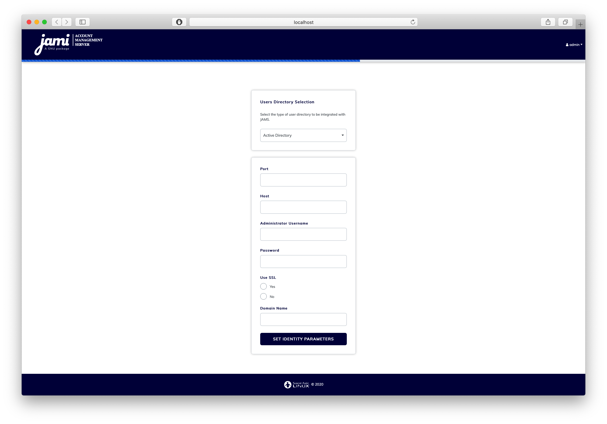
</p>

Your admin should provide you most of this information but we do provide a detailed overview over each field in case you need some extra help:

| Field         | Details       |
| ------------- |-------------  |
| **Port**      | The port on which Active Directory is listening (generally it is either 389 or 636) |
| **Host**     | The address of your server with respect to the JAMS server, your Active Directory does not need to be publicly accessible but should be accessible to JAMS. |
| **Administrator Username** | This is **NOT** the Active Directory's administration account credentials, but the credentials of the account which has Read permissions to the Active Directory database in order to lookup users. The format is generally ``cn=bot,ou=robots,dc=domain,dc=net``     |
| **Password** | The password used by the account above.     |
| **Use SSL** | Whenever this server uses SSL for data transmission    |
| **Domain Name** | This is the legacy-formatted Windows Domain Name (i.e. ``WINDOMAIN``)     |

<br/>

### Option 3: local embedded database

The local database does not require any additional configuration, everything in the process is automated. This option allows you to create Jami users on the fly directly from the JAMS interface.

<p align="center">
    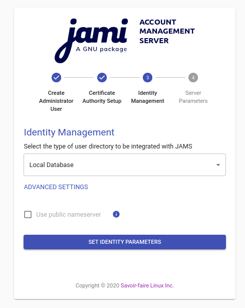
</p>

**Advanced settings:** by default, the option "Use public nameserver" is disabled. Usernames of your Jami users will not be stored on the public Jami nameserver and your users will only be able to communicate with users from your organization.

If you want your users to be searchable by external users and allow them to communicate with any Jami users, and not only the one from your organization, enable this option,

## Step 4: setup the server parameters

<p align="center">
    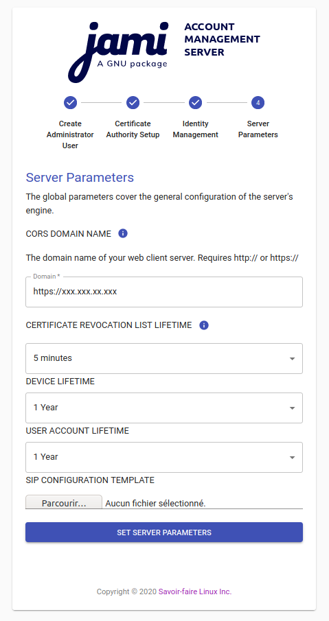
</p>

| Parameter         | Details       |
| ------------- |-------------  |
| **CORS Domain Name**      | The domain on which the JAMS client and administration UI will be running. |
| **Certificate Revocation List Lifetime**     | The frequency at which the CRL is updated in memory |
| **Device Lifetime** | How long a device's certificate is valid before being considered stale and requiring re-enrollement      |
| **User Account Lifetime** | How long a user account is valid before being considered stale and requiring re-enrollement  |


**Important** The *CORS Domain Name* corresponds to the web address used to access the Web UI. By default, it is set to the same URL as the one where you deploy JAMS. Only set a different URL if the Web UI has a different URL to the one where JAMS is deployed.

<br/>

Click on "Set Server Parameters" to finalize the configuration.
You will be redirected to the JAMS interface.

<p align="center">
    
</p>

If you have configured JAMS with your LDAP or Active Directory, the list of users should of your organization shoud be visible in JAMS. If you have selected the local embedded database, you can now start creating new users by clicking on "Create User"

## Troubleshooting and resetting

If you ever need to restart from 0 (i.e. reset everything and drop existing data) you can do so by deleting the following files in the distribution folder (<your project root folder>/jams):

```
The internal jams folder: <your project root folder>/jams/jams
derby.log
oauth.key
oauth.pub
config.json
```

This will reset the server to its original state and you will be able to run the configuration wizard again. Before performing this operation, please make sure to shutdown the server.

# Admin Guide

By default JAMS runs an embedded tomcat server visible on port 8080, however this is not practical for many reasons. This guide is designed
to help you setup Jams to run in a production environment.


## JAMS & Nginx

It is generally not recommended to expose JAMS directly to the outside world and while it is required to run JAMS in SSL mode, we usually
recommend users to place it behind Nginx or a similar web server which proxies requests between the outside world and Jams.

The following is an example map of how you could configure JAMS behind Nginx (the process would be similar if you wanted to use any other type of proxying solution):

<p align="center">
    
</p>

The IP 10.10.0.1 is random, and should be seen as an example.


Typically you would add a new site called ``jams-site.conf`` to your nginx configurations which would contain the following entries if you wanted to place an SSL certificate at the Nginx level:


```
server {
        listen 443 ssl;
        listen [::]:443 ssl;
        ssl on;
    	ssl_certificate /etc/certificates/mycertificate.pem
    	ssl_certificate_key /etc/certificates/mycertificatekey.pem
        client_max_body_size 100M;
        server_name jams.mycompany.com;
        location / {
                proxy_pass              http://10.10.0.1:8080/;
                proxy_set_header        X-Real-IP  $remote_addr;
                proxy_set_header        Host $http_host;
        }
}
```

This is the preferred setup method by most admins, as local traffic is usually ran unencrypted since it is usually either inter-VM connection, a VLAN or another dedicated link.


## Running JAMS as a Linux Service

Running JAMS as a Linux Service is fairly straightforward with systemd - you simply created a service unit file with the following structure:

```
[Unit]
Description=JAMS Server

[Service]
Type=simple
WorkingDirectory=[DIRECTORY WHERE JAMS WAS UNZIPPED]
ExecStart=/usr/bin/java -jar [DIRECTORY WHERE JAMS WAS UNZIPPED]/jams-launcher.jar PORT SSL_CERTIFICATE SSL_CERTIFICATE_KEY

[Install]
WantedBy=multi-user.target
```

The parameters PORT, SSL_CERTIFICATE and SSL_CERTIFICATE_KEY are optional (however, PORT can be used alone whereas the SSL_CERTIFICATE comes in pair with SSL_CERTIFICATE_KEY)

# Client Guide

Depending on your operating system, we have included the tutorial on how to connect to the management server from the Windows, MacOS, Android and iOS clients.


For the purposes of this tutorial, we assume that

1. The server and the device trying to connect are either
	1. On the same network
	2. The server is publicly accessible to the outside world
2. You have a valid username/password pair to connect to the server

## Connect from a Windows device

Open Jami, go to the login page. Click on "Advanced":

<p align="center">
    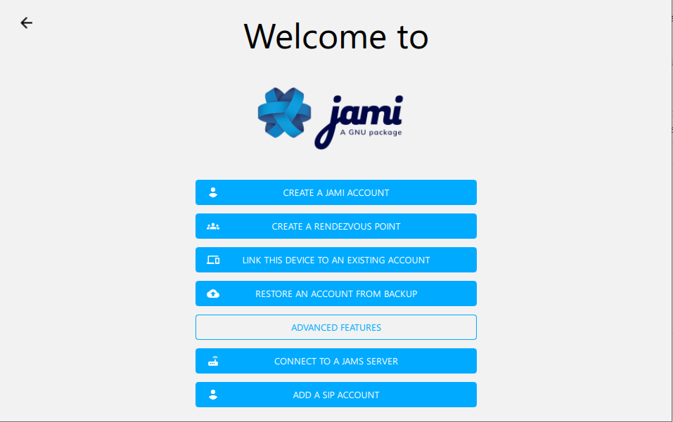
</p>

Select the option **"Connect to a JAMS server"** which will lead you to the following screen:
 
<p align="center">
    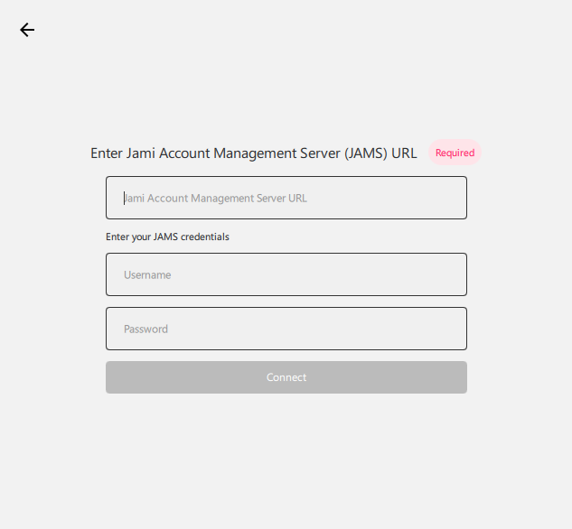
</p>

The ```Jami Account Management Server URL``` in this case would be the DNS address of your server and the username and password which correspond to your account. If you have configured the server with an LDAP/AD backend, it would be your LDAP/AD username and password.

## Connect from a MacOS device

Open Jami, go to the login page. Click on "Advanced":

<p align="center">
    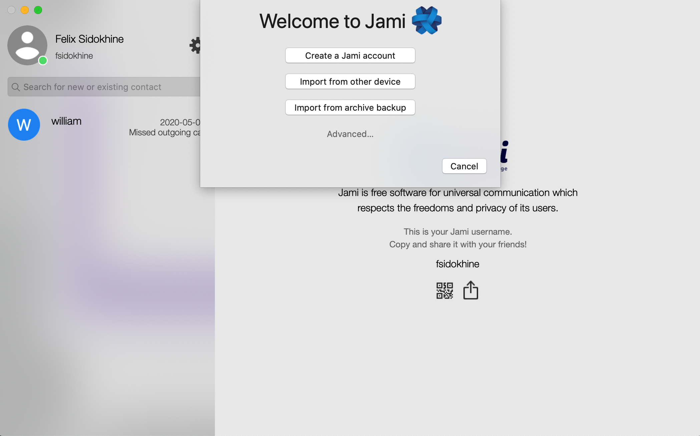
</p>

Select the option **"Connect to account manager"** which will lead you to the following screen:
 
<p align="center">
    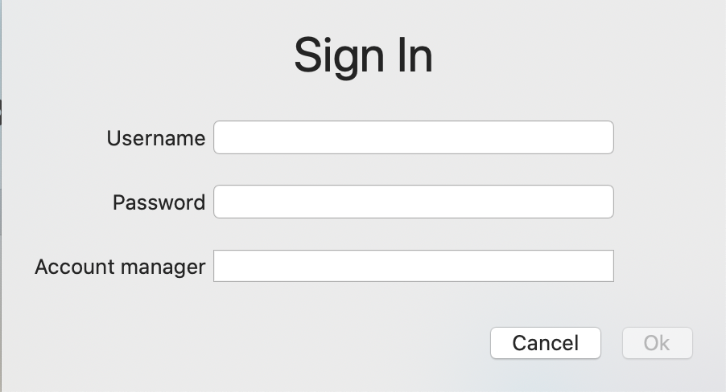
</p>

The ```Jami Account Management Server URL``` in this case would be the DNS address of your server and the username and password which correspond to your account. If you have configured the server with an LDAP/AD backend, it would be your LDAP/AD username and password.

## Connect from an Android device

Open Jami, go to the login page.

<p align="center">
    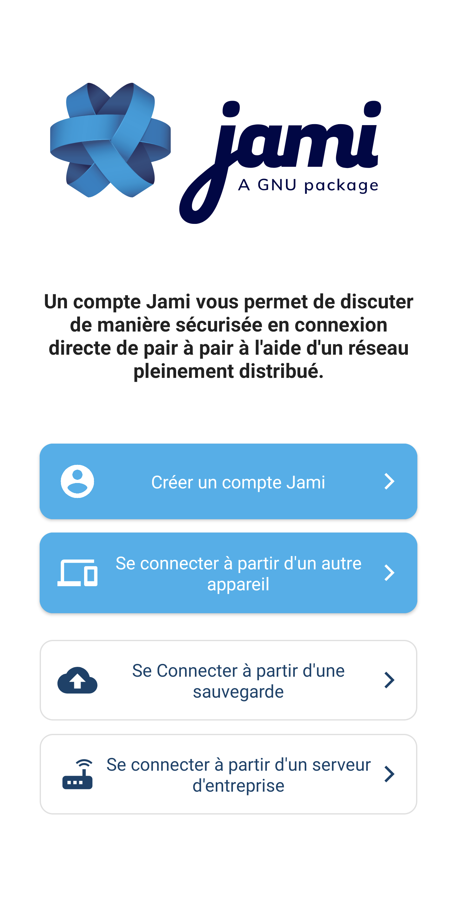
</p>

Select the option **"Connect to management server"** which will lead you to the following screen:

<p align="center">
    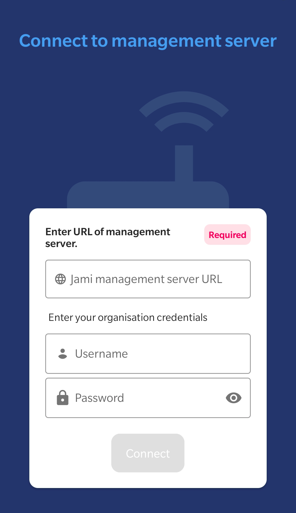
</p>

The server in this case would be the DNS address of your server and the username and password which correspond to your account. If you have configured the server with an LDAP/AD backend, it would be your LDAP/AD username and password.

## Connect from an iOS device

Open Jami, go to the login page.

<p align="center">
    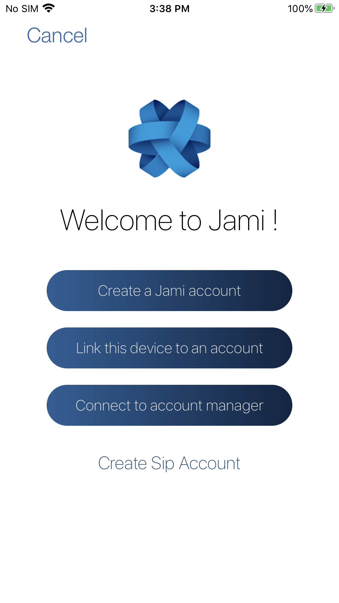
</p>

Select the option **"Connect to account manager"** which will lead you to the following screen:

<p align="center">
    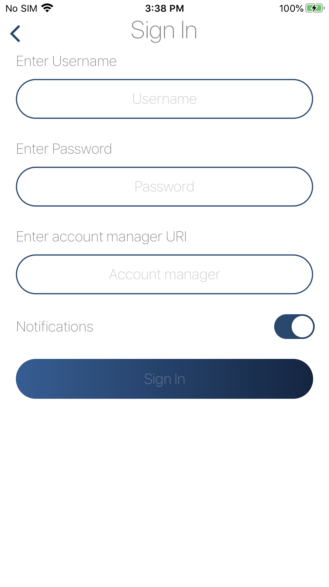
</p>

The server in this case would be the DNS address of your server and the username and password which correspond to your account. If you have configured the server with an LDAP/AD backend, it would be your LDAP/AD username and password.

