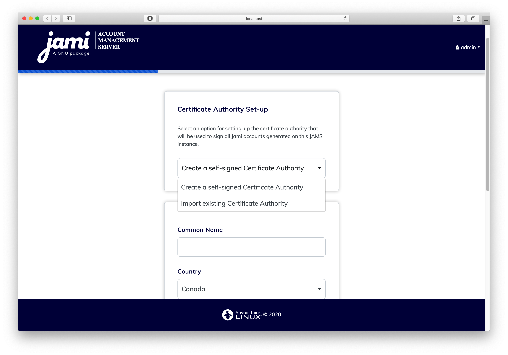
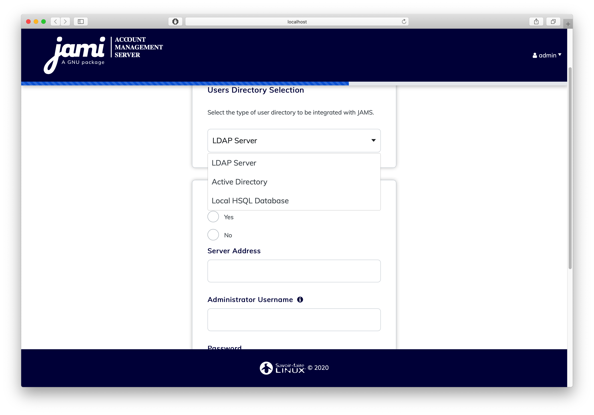

# Getting Started

JAMS is a server application used to enroll Jami clients into an enterprise context. Currently, JAMS supports 3 sources for user authentication: LDAP, Active Directory and an embedded database.

## Obtaining Jams

The current alpha build of JAMS can be downloaded at: ``https://``

## System Requirements

* Windows, Linux or Mac OS operating system
* Java 11 or higher
* 4 GB RAM
* 1 CPU 

## Jams Concepts

Jams was built with security in mind, therefore it is intimately related to the X509 certificate management workflows. 

The central concepts which are used in JAMS are the Certification Authority (CA) and the Certificate Signing Requests (CSR).

In the Jams paradigm, a device (Jami client) basically requests the server to issue a certificate to it in order to present it to other devices which lets them recognize the device as a valid member of the organization, therefore Jams MUST be provided with a certificate authority in order to function correctly. Please note that a CA is NOT a standard SSL server certificate, as they do not have the permission to issue certificates.

In order to be completely secure, Jams does not generate certificates for devices, but instead issues certificates based on a certificate signing request sent to it by the device, therefore removing the need to send a private key over the wire.

The diagram below shows the entire process of how a device enrolls with Jams:

<p align="center">
    
</p>

​    
## Getting Started

Download the latest version from: <https://dl.jami.net/jams/jams-alpha.zip>

Unpack the ZIP file to a directory of your choice.

To run the server, navigate to the directory where you have extracted the Jams package and execute ``java -jar jams-launcher.jar``

## Step 1: Create your admin account

This account will be used for administrative purposes, it is used to browse the user database, removing devices and performing other basic administrative tasks.

<p align="center">
    
</p>


## Step 2: Setup the Certification Authority

The second step is to define your Certification Authority. 

<span style="color:red"> **A CA IS NOT A SERVER-SIDE SSL CERTIFICATE, IT IS A CERTIFICATE WHICH HAS THE POWER TO ISSUE OTHER CERTIFICATES. DO NOT USE THE IMPORT OPTION UNLESS
	YOUR COMPANY'S SECURITY OFFICER HAS ISSUED YOU A CA CERTIFICATE. MOST COMMERICALLY AVAILABLE CERTIFICATES (I.E. THOSE ISSUED BY GODADDY, LETSENCRYPT, ETC... ) ARE NOT CA 
	CERTIFICATES. IF YOU ARE AN END-USER WE HIGHLY RECOMMEND YOU USE THE CREATE A SELF-SIGNED CA OPTION AS PROVIDING AN INCORRECT CERTIFICATE TYPE WILL LEAD TO A NON-FUNCTIONAL SERVER!!!** </span>

<p align="center">
    
</p>

This certificate will be used to sign the enrollement requests which come from Jami devices. If you are not familiar with the X509 standard, we highly recommend you read the following
articles to get familiar with the processes and practices which surround it:

<https://www.securew2.com/blog/public-key-infrastructure-explained/>
<https://cheapsslsecurity.com/blog/understanding-the-role-of-certificate-authorities-in-pki/> 

## Step 3: Setup the user database

Currently, Jams supports 3 sources of authentication of users:

1) LDAP-compatible directory (such as OpenLDAP)
2) Microsoft Active Directory
3) Local embedded database

<p align="center">
    
</p>

### LDAP Authentication source

If your company provides you with LDAP directory for user management, you will need to know its access information and a automated account which has read-only rights to do use look-ups.

<p align="center">
    
</p>

Your admin should provide you most of this information but we do provide a detailed overview over each field in case you need some extra help:

| Field         | Details       |
| ------------- |-------------  |
| **Use StartTLS**      | Your LDAP server can be configured to use either TLS/STARTTLS or PLAIN sockets, if STARTTLS is used you should mark this as true |
| **Server Address**     | The address of your server with respect to the JAMS server, your LDAP does not need to be publicly accessible but should be accessible to Jams. You should have either ``ldap://`` or ``ldaps://`` preceding the address.      |
| **Port** | The port on which the LDAP server is listening for requests (usually 389 for PLAIN/STARTTLS and 636 for SSL/TLS)      |
| **Administrator Username** | This is **NOT** the LDAP's administration account credentials, but the credentials of the account which has Read permissions to the LDAP database in order to lookup users. The format is generally ``cn=bot,ou=robots,dc=domain,dc=org``     |
| **Password** | The password used by the account above.     |
| **BaseDN** | The base realm where the users accounts are located, in most cases it is ``ou=users,dc=company,dc=org``     |


### Microsoft Active Directory

If your company provides you with Active Directory for user management, you will need to know its access information and a automated account which has read-only rights to do use look-ups.


<p align="center">
    
</p>

Your admin should provide you most of this information but we do provide a detailed overview over each field in case you need some extra help:

| Field         | Details       |
| ------------- |-------------  |
| **Port**      | The port on which Active Directory is listening (generally it is either 389 or 636) |
| **Host**     | The address of your server with respect to the JAMS server, your Active Directory does not need to be publicly accessible but should be accessible to Jams. |
| **Administrator Username** | This is **NOT** the Active Directory's administration account credentials, but the credentials of the account which has Read permissions to the Active Directory database in order to lookup users. The format is generally ``cn=bot,ou=robots,dc=domain,dc=net``     |
| **Password** | The password used by the account above.     |
| **Use SSL** | Whenever this server uses SSL for data transmission    |
| **Domain Name** | This is the legacy-formatted Windows Domain Name (i.e. ``WINDOMAIN``)     |


### Local Embedded Database

The local database does not require any additional configuration, everything in the process is automated.

<p align="center">
    
</p>


## Step 4: Server Parameters

<p align="center">
    
</p>

| Parameter         | Details       |
| ------------- |-------------  |
| **CORS Domain Name**      | The domain on which the JAMS client and administration UI will be running. |
| **Certificate Revocation List Lifetime**     | The frequency at which the CRL is updated in memory |
| **Device Lifetime** | How long a device's certificate is valid before being considered stale and requiring re-enrollement      |
| **User Account Lifetime** | How long a user account is valid before being considered stale and requiring re-enrollement  |


<span style="color:red"> IMPORTANT NOTICE REGARDING THE FIELD **CORS Domain Name** </span> Many users have trouble with this part of the installation, to make it explicitly clear, this is web address used to access the Web UI. For example, if you expect users to access the Web UI by visiting the URL ``http://jams.mycompany.com`` then you should set the **CORS Domain Name** field to ``http://jams.mycompany.com``.

## Troubleshooting and resetting

If you ever need to restart from 0 (i.e. reset everything and drop existing data) you can do so by deleting the following files in the Jams directory:

```
jams.tmp/
jams.script
jams.properties
tomcat.8080/
config.json
keystore.jks
jams.log
tmpjar/
jams.lck
```

This will reset the server to its original state and you will be able to run the configuration wizard again. Please make sure to shutdown the server before
doing performing this operation.
